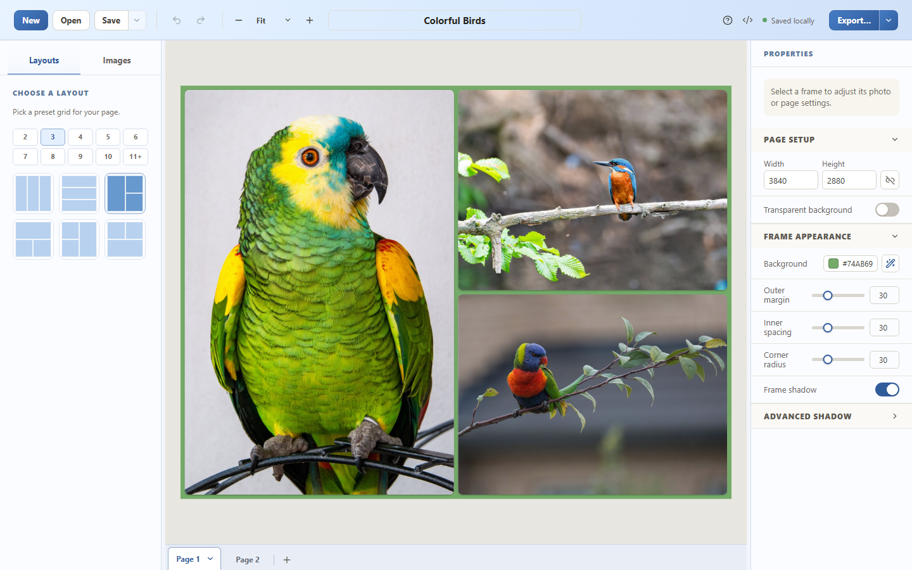

# Collage Builder

Create photo collages right in your browser. Choose a layout, arrange your photos, and download a finished collage — no installation or account needed. Your photos stay on your device.

**[Open Collage Builder](https://t1m0thyj.github.io/collage-builder/)**

[](https://t1m0thyj.github.io/collage-builder/)

[Download the sample collage](https://github.com/t1m0thyj/collage-builder/raw/refs/heads/main/docs/examples/sample.collage) to try it yourself. Bird photos are royalty-free under the [Pexels License](https://www.pexels.com/license/) [\[1\]](https://www.pexels.com/photo/portrait-of-colorful-parrot-5541474/ 'Parrot — David Vives') [\[2\]](https://www.pexels.com/photo/kingfisher-bird-on-tree-branch-12549181/ 'Kingfisher — Siegfried Poepperl') [\[3\]](https://www.pexels.com/photo/colorful-parrot-on-tree-branch-6222481/ 'Rainbow lorikeet — Brian Cook').

## Make your first collage

1. [Open the app](https://t1m0thyj.github.io/collage-builder/) and choose **Import images**, or drag your photos into the editor.
2. Pick a layout and drag photos into its frames.
3. Adjust the crop, spacing, rounded corners, background color, and shadows to suit your photos.
4. Choose **Export** to download your collage as PNG or JPEG.

Use **Save** to keep an editable `.collage` project with your photos included, then **Open** it to continue later. To recreate the screenshot, open the sample linked above. The [user guide](docs/USER_GUIDE.md) covers more options and keyboard shortcuts.

For the best experience, use a desktop or tablet with a browser window at least 768 pixels wide.

## Features

- **Flexible layouts:** arrange your photos in rectangular frames and customize their appearance.
- **Multiple pages:** create a collection of collages in one project; export a single page, all pages, or a range.
- **Common photo formats:** import JPEG, PNG, WebP, HEIC, and HEIF images.
- **Editable projects:** save everything in a portable `.collage` file, or use a smaller `.collage.json` project that links to your image files.
- **Private editing:** photos, projects, and recovery saves stay in your browser unless you save or export them. Read the [privacy details](PRIVACY.md).
- **Offline access:** after one complete visit, the app can reload without an internet connection. See [offline use](docs/OFFLINE.md).

The app keeps recent recovery saves in your browser, but save a project file to keep your work long-term. Clearing browser site data removes recovery saves.

## Help and feedback

- [User guide](docs/USER_GUIDE.md)
- [Support and bug reports](SUPPORT.md)
- [Changelog](CHANGELOG.md)
- [Security policy](SECURITY.md)

## Development and self-hosting

To run Collage Builder locally:

Requires Bun 1.4 or newer. The development and CI version is pinned in `.bun-version`.

```sh
bun install --frozen-lockfile
bun run dev
```

For a production build, run `bun run build`. The output in `dist/` can be served by any static HTTPS host.

See the [development guide](docs/DEVELOPMENT.md), [self-hosting instructions](docs/OFFLINE.md), and [release process](docs/RELEASING.md) for more details.

## License

Copyright 2026 Timothy Johnson. Licensed under the [Apache License 2.0](LICENSE). Third-party components remain under their own licenses.
